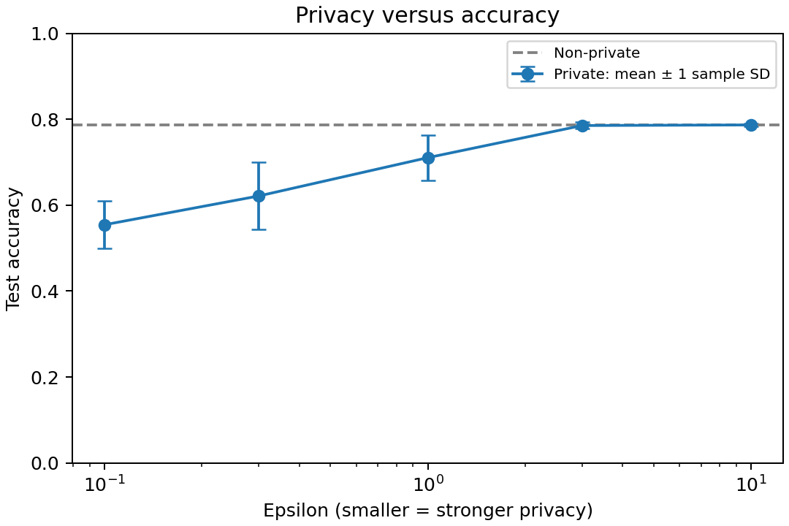

# DP Learning Lab

How does differential privacy affect a classifier's accuracy?

This small learning project compares ordinary logistic regression with
private logistic regression on synthetic binary classification data.
The commit history builds it in five short, runnable steps.

## Setup

Use Python 3.11–3.13. The dependency versions were tested on Python 3.12.

```bash
python3 -m venv .venv
source .venv/bin/activate
python -m pip install -r requirements.txt
python experiment.py
```

The script prints accuracy and saves each run to `results/runs.csv` and the
comparison chart to `results/accuracy.png`. Rerunning replaces those two files.

## Results



The committed run produced these mean test accuracies over ten fits per epsilon:

| Epsilon | Mean accuracy | Sample standard deviation |
| --- | --- | --- |
| 0.1 | 55.4% | 5.6 percentage points |
| 0.3 | 62.1% | 7.8 percentage points |
| 1 | 71.1% | 5.3 percentage points |
| 3 | 78.5% | 0.8 percentage points |
| 10 | 78.7% | 0.4 percentage points |

The non-private baseline scored **78.6%**. In this run, stronger privacy cost
accuracy, while epsilon 3 and 10 approached the baseline. Error bars summarize
noise variation on one fixed dataset, not uncertainty across datasets. The table
describes the committed CSV; a fresh run will give different numbers.

## Baseline

The script generates 1,200 synthetic examples with six features and two labels.
It trains ordinary logistic regression on 840 examples and evaluates accuracy
on the other 360. Fixed random seeds make the data and split reproducible.
The current baseline scores about 78.6% accuracy.

Each feature vector is clipped to L2 norm at most one: long vectors shrink,
while shorter vectors stay unchanged. This public bound prepares a fair
comparison with private models. Clipping alone does not make training
private; this baseline provides the reference accuracy without privacy noise.

## Private models

The script also trains private logistic regression at epsilon 0.1, 0.3, 1, 3,
and 10. Smaller epsilon means a stronger privacy bound. Each setting is run ten
times on the same data, with fresh privacy noise. The printed mean accuracy and
sample standard deviation show how utility varies across those noise draws;
the standard deviation is not a confidence interval.

The private implementation comes from [IBM diffprivlib](https://diffprivlib.readthedocs.io/en/latest/modules/models.html#logistic-regression)
and uses objective perturbation. We supply the public norm bound of one rather
than estimating it from data. Each fit uses its selected epsilon and delta zero
under the library's assumptions. A shared accountant tracks repeated training:
the whole sweep composes to epsilon **144**, delta **0**, rather than the epsilon
of any individual fit. The ordinary baseline is not covered by this accountant.

Only the synthetic data and split are seeded; privacy noise is not, so scores
change between runs and need not increase monotonically with epsilon. This is
a synthetic-data learning experiment with a public binary label domain. For real
private data, label discovery, splitting, test-set metrics, model selection, and
repeated releases require additional privacy analysis. Do not publish ordinary
accuracy from a private test set without protection. This is not a deployment
pipeline for sensitive data.

## Tests

```bash
python -m unittest -v
```

Three tests check that clipping handles zero and signed vectors without changing
the input, that every repeated private fit contributes to the total budget, and
that separate evaluations do not accidentally share accounting state. They also
check run coverage and valid accuracy values without depending on random scores.
These checks catch implementation mistakes; passing them does not prove privacy.

## Build sequence

1. Set up the project and dependencies (done).
2. Generate synthetic data and train a non-private baseline (done).
3. Compare private models across privacy budgets (done).
4. Test feature clipping and privacy accounting (done).
5. Save results and explain the accuracy tradeoff (done).

This experiment evaluates utility; an accuracy curve cannot prove differential
privacy. The guarantee depends on the mechanism and its assumptions. All
examples use synthetic, non-sensitive data.

## Try next

Change `n_samples` in `dataset()` to 300 and then 3000 while keeping other
settings fixed. Does having more training data reduce the accuracy cost of
privacy at the same epsilon?

## References

- [diffprivlib privacy accountant](https://diffprivlib.readthedocs.io/en/latest/modules/accountant.html)
- [Differentially Private Empirical Risk Minimization](https://jmlr.org/papers/v12/chaudhuri11a.html)
